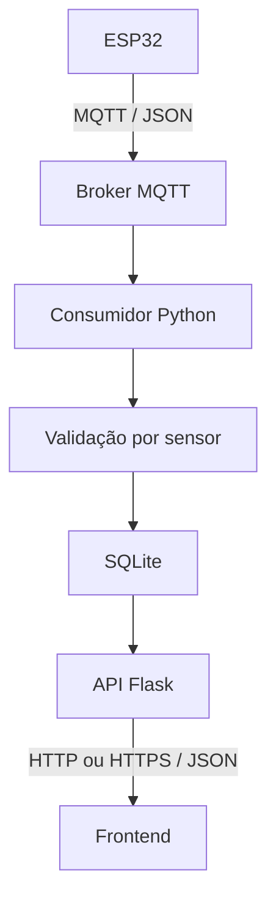

# Estação Meteorológica IoT — Backend Python

**Vídeo de demonstração:** inserir link do vídeo.

**Dashboard:** https://estacao-meteorologica-front.onrender.com

**API:** https://estacao-meteorologica-backend-k3q0.onrender.com

## Sobre o projeto

Backend de uma estação meteorológica acadêmica voltada ao monitoramento ambiental local e à aplicação de conceitos de Cidades Inteligentes.

O sistema recebe mensagens MQTT publicadas pelo ESP32, valida os dados, armazena as leituras em SQLite e disponibiliza uma API HTTP para o dashboard.

## Arquitetura



O consumidor MQTT e a API são processos separados, mantidos no mesmo repositório. Ambos utilizam o mesmo arquivo SQLite.

A API Flask não recebe diretamente as publicações MQTT.

## Tecnologias

- Python.
- Flask.
- Flask-CORS.
- Paho MQTT.
- SQLite, por meio do módulo `sqlite3`.
- Gunicorn.
- Supervisor.

## Estrutura

| Arquivo | Responsabilidade |
| --- | --- |
| `consumidor.py` | Assinatura MQTT e processamento das mensagens |
| `validacao.py` | Validação estrutural e dos dados dos sensores |
| `banco.py` | Inicialização, migração, inserção e consulta |
| `app.py` | Rotas HTTP e configuração CORS |
| `config.py` | Configuração do broker e tópico |
| `requirements.txt` | Dependências Python |
| `start.sh` | Inicialização do ambiente de execução |
| `supervisord.conf` | Gerenciamento da API e do consumidor |

## Instalação local no Ubuntu

```bash
git clone https://github.com/Shamoleambo/ESP32-backend.git
cd ESP32-backend

python3 -m venv .venv
source .venv/bin/activate

python -m pip install -r requirements.txt
```

SQLite é acessado pelo módulo `sqlite3`, normalmente disponível na instalação Python. Não é necessário iniciar um servidor de banco separado.

## Configuração MQTT

Os parâmetros estão em `config.py`:

```python
MQTT_SERVIDOR = "test.mosquitto.org"
MQTT_PORTA = 1883
MQTT_TOPICO = "pi-meteorologia/781c3cda41d0/leituras"
```

O tópico precisa coincidir exatamente com o utilizado pelo ESP32.

O broker público é utilizado sem autenticação e sem TLS nesta configuração. Ele não deve ser tratado como infraestrutura com garantia de disponibilidade.

## Configuração da estação

A localização é cadastrada por variáveis de ambiente. Não é obtida por GPS no ESP32.

No terminal em que a API será iniciada:

```bash
export ESTACAO_NOME="Estação meteorológica"

# Coordenadas ilustrativas: substituir pela localização real.
export ESTACAO_LATITUDE="-23.5505"
export ESTACAO_LONGITUDE="-46.6333"
```

Utilizar graus decimais com ponto decimal.

Sem coordenadas válidas, `/api/estacao` retorna HTTP 503. As rotas de leituras continuam independentes.

## Executar localmente

### Terminal 1 — Consumidor MQTT

Na pasta do backend:

```bash
source .venv/bin/activate
python consumidor.py
```

O consumidor inicializa o banco, conecta ao broker e solicita a assinatura do tópico.

Quando uma mensagem é aceita e persistida, o terminal apresenta:

```text
Leitura salva: estacao-01 sequência ...
```

### Terminal 2 — API Flask

Na mesma pasta, em outro terminal:

```bash
source .venv/bin/activate
python -m flask --app app run
```

Endereço local:

```text
http://127.0.0.1:5000
```

Manter os dois processos em execução para receber novas leituras e disponibilizá-las pela API.

O servidor Flask de desenvolvimento é utilizado apenas na execução local. Na implantação, a aplicação utiliza Gunicorn.

## Endpoints

| Método | Rota | Descrição |
| --- | --- | --- |
| GET | `/api/status` | Confirma que a API está respondendo |
| GET | `/api/leituras/ultima` | Retorna o último registro armazenado |
| GET | `/api/estacao` | Retorna nome e localização cadastrada |

### Status

```bash
curl http://127.0.0.1:5000/api/status
```

Exemplo de resposta:

```json
{
  "status": "ok",
  "servico": "backend-estacao-meteorologica"
}
```

Essa resposta não comprova que o consumidor esteja recebendo novas mensagens.

### Última leitura

```bash
curl http://127.0.0.1:5000/api/leituras/ultima
```

Exemplo ilustrativo:

```json
{
  "versao": 3,
  "id": 1,
  "estacao_id": "estacao-01",
  "sequencia": 1,
  "leituras": {
    "temperatura_c": 26.2,
    "umidade_pct": 68.3,
    "pressao_hpa": 925.7,
    "mq135_adc": 240,
    "luminosidade_adc": null,
    "luminosidade_digital": 0
  },
  "estado_sensores": {
    "dht22": "ok",
    "bmp280": "ok",
    "mq135": "ok",
    "ldr": "ok"
  },
  "recebido_em": "2026-11-13T16:20:00+00:00"
}
```

O campo `recebido_em` é atribuído pelo backend em UTC no momento da persistência. Não representa o horário de aquisição na placa.

Se ainda não houver registros, a rota retorna HTTP 404.

### Localização

```bash
curl http://127.0.0.1:5000/api/estacao
```

Exemplo ilustrativo:

```json
{
  "estacao_id": "estacao-01",
  "nome": "Estação meteorológica",
  "latitude": -23.5505,
  "longitude": -46.6333,
  "origem_localizacao": "cadastro_manual"
}
```

As mesmas requisições podem ser executadas no Postman.

## Validação das mensagens

A validação aceita versões 1, 2 e 3 e normaliza o resultado para a versão 3.

São verificados:

- Estrutura do objeto JSON.
- Versão suportada.
- Identificação `estacao-01`.
- Sequência inteira positiva.
- Campos obrigatórios.
- Estados dos sensores.
- Tipos numéricos, valores finitos e intervalos aceitos.

| Campo | Intervalo aceito |
| --- | --- |
| `temperatura_c` | −40 a 80 °C |
| `umidade_pct` | 0 a 100 % |
| `pressao_hpa` | 300 a 1100 hPa |
| `mq135_adc` | Inteiro de 0 a 4095 |
| `luminosidade_digital` | Inteiro 0 ou 1 |

Estados aceitos:

```text
ok
erro_leitura
nao_configurado
aquecendo
```

### Falhas estruturais

Mensagens com estrutura inválida são descartadas.

### Falhas em um sensor

Se uma leitura de um grupo estiver inválida, os campos daquele sensor são normalizados para `null`, com estado `erro_leitura`. Os demais grupos válidos são preservados.

Por exemplo, uma temperatura de 150 °C invalida temperatura e umidade do DHT22, sem eliminar uma leitura válida do BMP280.

Não estão implementadas médias móveis, filtragem temporal de outliers ou estatísticas históricas. Validação de faixa não equivale a calibração.

## Banco de dados

O banco atual utiliza uma tabela física, `leituras`.

| Coluna | Tipo SQLite | Descrição |
| --- | --- | --- |
| `id` | INTEGER | Chave primária autoincremental |
| `estacao_id` | TEXT | Identificação da estação |
| `sequencia` | INTEGER | Contador enviado pelo firmware |
| `temperatura_c` | REAL | Temperatura ou NULL |
| `umidade_pct` | REAL | Umidade ou NULL |
| `pressao_hpa` | REAL | Pressão ou NULL |
| `mq135_adc` | INTEGER | ADC bruto ou NULL |
| `luminosidade_adc` | INTEGER | Campo legado |
| `luminosidade_digital` | INTEGER | 0, 1 ou NULL |
| `estado_sensores` | TEXT | Estados serializados como JSON |
| `recebido_em` | TEXT | Data/hora UTC em ISO 8601 |

As colunas de leitura possuem restrições de faixa no esquema.

Não há tabela separada de estações ou chave estrangeira nesta versão. A sequência do firmware não é única, pois reinicia com a placa.

O caminho é definido pela variável `CAMINHO_BANCO`. Sem essa variável, o arquivo utilizado é `estacao.sqlite3`, junto ao código.

A inicialização pode ser chamada pela API e pelo consumidor para permitir a execução independente dos processos.

Não versionar arquivos `.sqlite3` e seus arquivos auxiliares.

## Consultar os registros

Na pasta do backend, com o ambiente e as variáveis corretos, executar localmente ou no Shell do serviço:

```bash
python - <<'PY'
import sqlite3
from contextlib import closing
from banco import CAMINHO_BANCO

uri = CAMINHO_BANCO.resolve().as_uri() + "?mode=ro"

with closing(sqlite3.connect(uri, uri=True)) as conexao:
    conexao.row_factory = sqlite3.Row

    print("Banco:", CAMINHO_BANCO)
    print(
        "Total de registros:",
        conexao.execute("SELECT COUNT(*) FROM leituras").fetchone()[0]
    )

    for registro in conexao.execute(
        "SELECT * FROM leituras ORDER BY id DESC LIMIT 5"
    ):
        print(dict(registro))
PY
```

A consulta utiliza modo somente leitura e pressupõe que o banco já tenha sido inicializado.

## CORS

As origens permitidas são configuradas em `app.py`.

Uma origem contém protocolo, endereço e porta. Por isso, estes endereços são diferentes:

```text
http://127.0.0.1:8000
http://localhost:8000
```

Ao publicar o frontend em outro domínio, acrescentar sua origem exata à lista autorizada.

Um HTTP 200 pode aparecer no backend enquanto o navegador bloqueia o acesso à resposta por CORS.

## Implantação no Render

API e consumidor executam no mesmo Web Service, compartilhando o SQLite.

| Configuração | Valor |
| --- | --- |
| Build Command | `pip install -r requirements.txt` |
| Start Command | `sh start.sh` |
| Health Check Path | `/api/status` |
| Montagem do disco persistente | `/var/data` |
| `CAMINHO_BANCO` | `/var/data/estacao.sqlite3` |

Configurar também:

```text
ESTACAO_NOME
ESTACAO_LATITUDE
ESTACAO_LONGITUDE
```

O Render fornece a variável `PORT`, utilizada pelo Gunicorn.

O Supervisor mantém os processos da API e do consumidor. A implantação utiliza uma instância com disco persistente; apenas arquivos dentro da montagem são preservados.

## Verificar persistência

1. Interromper temporariamente as publicações da placa.
2. Consultar e anotar a contagem e os registros existentes.
3. Reiniciar o serviço.
4. Conferir os mesmos registros antes de retomar as publicações.
5. Retomar o envio e verificar novas inserções.

O aumento da contagem comprova inserção, mas não comprova preservação após reinicialização.

## Testes recomendados

- Mensagem válida.
- JSON inválido.
- Versão ou estação inválida.
- Valor fora do intervalo.
- Falha isolada de um sensor.
- Consulta da última leitura.
- Banco inicialmente vazio.
- Localização ausente ou inválida.
- CORS.
- Persistência após reinício.
- Retomada do recebimento após falha de conexão.

Registrar as evidências e os resultados reais.

## Limitações

- Apenas uma estação é aceita pela validação atual.
- Sem rota de consulta histórica.
- Sem médias móveis ou detecção temporal de outliers.
- Sem autenticação de API.
- MQTT público sem autenticação ou TLS.
- MQ-135 armazenado como ADC bruto, sem conversão para ppm.

## Documentação visual

Acrescentar:

- Diagrama da arquitetura.
- Captura da recepção MQTT.
- Captura dos registros SQLite.
- Evidência de consulta no Postman.
- Evidência da persistência após reinício.

Ocultar credenciais e informações sensíveis nas capturas.

## Repositórios relacionados

- Firmware: https://github.com/Shamoleambo/ESP32
- Backend: https://github.com/Shamoleambo/ESP32-backend
- Frontend: https://github.com/Shamoleambo/ESP32-frontend
